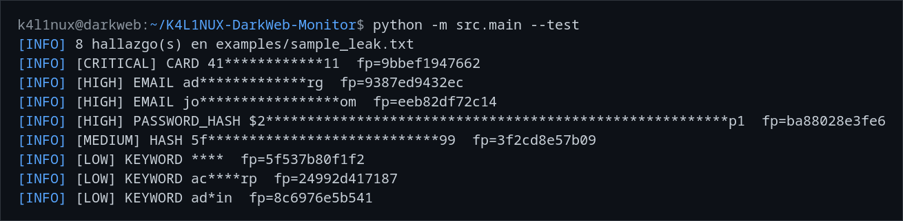

# 🕵️‍♂️ K4L1NUX Dark Web Monitor

[](https://github.com/DarkHater01/K4L1NUX-DarkWeb-Monitor/actions/workflows/ci.yml)
[](https://www.python.org/downloads/)
[](tests/)
[](https://opensource.org/licenses/MIT)

**Monitor defensivo que escanea la Dark Web para detectar filtraciones de datos antes de que sean explotadas**

⚠️ **Aviso importante**: Este proyecto es 100% educativo. No almacena datos personales y usa hashing para proteger la privacidad.

---

## ⚡ Demo rápida (sin Tor, 30 segundos)

```bash
git clone https://github.com/DarkHater01/K4L1NUX-DarkWeb-Monitor.git
cd K4L1NUX-DarkWeb-Monitor
pip install -r requirements.txt

# Escanea un ejemplo sintético incluido y muestra los hallazgos
python -m src.main --test
```

Salida esperada:

```
[INFO] 8 hallazgo(s) en examples/sample_leak.txt
[INFO] [CRITICAL] CARD 41************11  fp=9bbef1947662
[INFO] [HIGH] EMAIL jo*****************om  fp=eeb82df72c14
[INFO] [MEDIUM] HASH 5f****************************99  fp=3f2cd8e57b09
...
```



---

## 🔍 Motor de detección

El núcleo es un motor de detección **offline y determinista** (`src/modules/leak_detector.py`),
testeable sin red ni Tor. Detecta:

| Tipo | Severidad | Regla |
|------|-----------|-------|
| 💳 Tarjeta | CRITICAL | patrón + validación **Luhn** |
| 🔑 Email | HIGH | regex |
| 🔐 Hash bcrypt | HIGH | `$2a/$2b/$2y$` |
| # Hash md5/sha | MEDIUM | 32–64 hex |
| 🔎 Keyword | LOW | lista en `config/keywords.txt` |

Cada hallazgo se guarda **enmascarado** y con `fingerprint` SHA-256: nunca se
persiste el valor en claro.

---

## 🎯 ¿Para quién es esto?

- 🔐 **Equipos de SOC** - Monitoreo proactivo de filtraciones
- 🏢 **Empresas** - Protección de datos corporativos  
- 🎓 **Estudiantes de ciberseguridad** - Aprender sobre OSINT/Tor
- 🔍 **Investigadores** - Búsqueda ética en la dark web

---

## 🚀 Características Principales

- ✔ Motor de detección de leaks (tarjetas con Luhn, emails, hashes, keywords)
- ✔ Modo **offline** para auditar ficheros locales (sin Tor)
- ✔ Scraping anónimo a través de **Tor** (`--url`)
- ✔ Alertas por **Telegram**
- ✔ Exportación en **JSON**
- ✔ Arquitectura modular y con **tests** (pytest + CI)
- ✔ Dockerfile incluido (ejecución aislada)

---

## 🛡️ Características de Seguridad

- ✅ **Sin almacenamiento de datos crudos** - Solo máscara + fingerprint SHA-256
- ✅ **Solo lectura** - No interactúa con sitios
- ✅ **Anonimato** - El tráfico `--url` pasa por Tor; las alertas salen directas
- ✅ **Sal configurable** - `K4L1NUX_SALT` para fingerprints por-deployment

---

## 🧱 Estructura del proyecto

```
K4L1NUX-DarkWeb-Monitor/
├── src/
│   ├── core/           # Tor client, parser HTML, hasher, alertas
│   ├── modules/        # Motor de detección de leaks
│   ├── utils/          # Logger, config loader
│   └── main.py         # Entry point (CLI)
├── config/             # Keywords y settings (Telegram)
├── examples/           # Muestra sintética para el modo --test
├── tests/              # Suite pytest
├── requirements.txt    # Dependencias Python
└── Dockerfile          # Contenedor aislado
```

---

## 🔧 Requisitos

- Python 3.10+
- Para el modo `--url`: Tor corriendo en `socks5h://127.0.0.1:9050`
- El modo `--test` y `--file` **no** requieren Tor

### Instalar dependencias:

```bash
pip install -r requirements.txt
```

### Instalar Tor (Ubuntu/Debian):

```bash
sudo apt update
sudo apt install tor
sudo systemctl start tor
```

---

## ▶️ Uso

```bash
# Demo offline con el ejemplo incluido (sin Tor)
python -m src.main --test

# Auditar un fichero local
python -m src.main --file /ruta/dump.txt

# Escanear un .onion a través de Tor
python -m src.main --url http://xxxxx.onion

# Salida en JSON
python -m src.main --test --json

# Keywords personalizadas
python -m src.main --file dump.txt --keywords config/my_keywords.txt
```

Las alertas por Telegram solo se envían si `telegram.enabled: true` en
`config/settings.yaml` y hay hallazgos.

---

## 📦 Docker

### Build de la imagen:

```bash
docker build -t k4linux-darkweb-monitor .
```

### Ejecutar con Docker:

```bash
docker run --rm --network host k4linux-darkweb-monitor --test
```

---

## ⚙️ Configuración

### `config/settings.yaml`:

```yaml
telegram:
  enabled: false          # ponlo en true para enviar alertas
  token: "your token"
  chat_id: "your id telegram"
```

### `config/keywords.txt`:

```
@miempresa.com
admin
database leak
```

---

## 🧪 Tests

```bash
pip install pytest
python -m pytest -q
```

---

## 🗺️ Roadmap 2026

### v1.0 (Estable) — actual
- [x] Motor de detección offline (Luhn, emails, hashes, keywords)
- [x] Modos `--test` / `--file` / `--url`
- [x] Tests + CI
- [ ] Módulos de foros .onion específicos
- [ ] Dashboard web básico

### v2.0
- [ ] Enriquecimiento con HaveIBeenPwned
- [ ] API REST
- [ ] Plugins para SIEM (Splunk, Elastic)

---

## 🛡️ Ética & Legal

Este proyecto es solo para **fines educativos y de ciberseguridad defensiva**.  
El scraping de la Dark Web implica riesgos; úsalo bajo tu responsabilidad.

### Normas de uso ético:
1. Solo monitorea datos de organizaciones que tienes autorización para proteger
2. No almacenes información personal identificable (PII)
3. Respeta los términos de servicio de los sitios
4. No uses para actividades ilegales

---

## ⭐ Contribuciones

Las contribuciones están abiertas. Sigue estos pasos:

1. Haz fork del repositorio
2. Crea una rama (`git checkout -b feature/AmazingFeature`)
3. Commit tus cambios (`git commit -m 'Add AmazingFeature'`)
4. Push a la rama (`git push origin feature/AmazingFeature`)
5. Abre un Pull Request

### Issues sugeridos para empezar:
- 🔧 Añadir soporte para más sitios .onion
- 📊 Mejorar sistema de exportación
- 🎨 Crear interfaz web básica
- 🔍 Optimizar detección de patrones

---

## 📚 Aprende más

- [Documentación de Tor](https://support.torproject.org/)
- [OSINT Framework](https://osintframework.com/)
- [Ética en ciberseguridad](https://www.eccouncil.org/cybersecurity-exchange/ethical-hacking/ethical-hacking-ethics/)

---

## 🤝 ¿Te gusta este proyecto?

1. **Dale una estrella** ⭐ - Ayuda a que más gente lo descubra
2. **Haz fork** - Mejora tu versión
3. **Contribuye** - Abre un issue o un Pull Request
4. **Comparte** - En Twitter, LinkedIn, con tu equipo

## 📢 ¿Usas esto en tu empresa?
¡Nos encantaría saberlo! Abre un issue o contáctanos.

## ☕ ¿Quieres apoyar el desarrollo?
Considera [sponsorizar](https://github.com/sponsors/DarkHater01) para nuevas features.

---

## 📄 Licencia

Distribuido bajo la licencia MIT. Ver `LICENSE` para más información.

## 📞 Contacto

Hermes David García Matos (K4L1NUX) - [@cyber_dark_hater](https://youtube.com/@cyber_dark_hater) - cyberdarkdavids@gmail.com

Link del proyecto: [https://github.com/DarkHater01/K4L1NUX-DarkWeb-Monitor](https://github.com/DarkHater01/K4L1NUX-DarkWeb-Monitor)

---

```
🛡️ K4L1NUX 
   ___       __   __    ___  _   _ _  __
  / _ \___  / /  / /   / _ \/ | / | |/ /
 / // / _ \/ /__/ /__ / , _/| |/ /|   / 
/____/\___/____/____/_/|_| |___/ |__/  
     DARK WEB MONITOR v0.1
```

**"Protegiendo datos, preservando privacidad"** 🔒